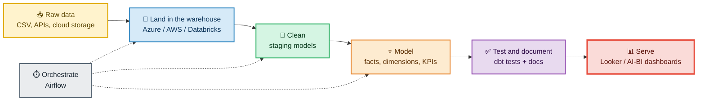

*I turn messy raw data into tested, documented models and dashboards that people can trust.*

**[🧑‍💻 About](#about) · [🧰 Stack](#stack) · [🗺️ How I work](#how) · [⭐ Project](#project) · [🎯 Focus](#focus) · [📊 Stats](#stats) · [📬 Contact](#contact)**

---

## 🧑‍💻 About me

- 💼 **Working Student, Analytics Engineer at Kleinanzeigen** (Berlin)
- 🎓 **M.Sc. International Project Management & Data Science** at HTW Berlin
- 🛠️ I build the layer between raw data and decisions: **ingestion → modelling → testing → dashboards**
- 🔍 I care about **trusted numbers**: clear grain, one definition per metric, automated data tests, documented models
- 📬 **Open to full-time roles** in data engineering and analytics engineering

---

## 🧰 Tech stack

**Languages & query**

**Transformation & orchestration**

**Cloud**

**BI & AI tools**

---

## 🗺️ How I work

---

## ⭐ Featured project

### 🛍️ [TheLook E-Commerce Analytics: dbt + Databricks](https://github.com/swadeshpanda/Thelook-ecommerce-dbt-databricks)

*End-to-end analytics engineering: raw CSVs → tested star schema → live AI/BI dashboard*

| 📈 Result | |
|---|---|
| **Revenue** | $8.13M from valid orders |
| **Average order value** | $86.38 |
| **Repeat customers** | 30.9% of customers who ordered came back |
| **Raw data** | 2.8M+ rows across 7 tables |

<b>🔎 What I built (click to expand)</b>

 

- 🧹 **7 staging views** with renamed keys, `DECIMAL` money and PII removed
- 🔗 **Intermediate layer** joining each sale to the real unit cost from inventory
- ⭐ **Star schema**: `fct_order_items`, `fct_orders`, `dim_customers`, `dim_products`
- 📊 **KPI marts** for finance (`mart_monthly_sales`) and merchandising (`mart_category_performance`)
- ✅ **Data tests** on keys, relationships and accepted values, plus a business-rule test
- 🧩 **Jinja macro** that generates per-status order counts from one project variable
- 🖥️ **AI/BI dashboard** declared as a dbt exposure, so it shows up in the lineage

<b>🧠 Design choices I'm proud of (click to expand)</b>

 

- **Cost from the unit actually sold**, not the catalogue price, so historical profit doesn't move when prices change
- **Aggregate before joining** to avoid double-counting (fan-out)
- **One definition of a valid order**, defined once and reused by every KPI
- **PII dropped in staging**, so it never reaches downstream models or the dashboard

---

## 🎯 What I'm focused on

| 🔭 Now | 🌱 Learning | 🤝 Looking for |
|---|---|---|
| Analytics engineering at Kleinanzeigen | CI for dbt, incremental models, snapshots | Full-time data engineering and analytics engineering roles |
| Building end-to-end dbt projects | Airflow orchestration patterns | Teams that care about tested, documented data |
| Master's in Data Science at HTW Berlin | Using AI tools such as Claude to work faster, with review | Open-source and team projects on BI and data quality |

---

## 📊 GitHub stats

<a href="#top">⬆️ back to top</a>

---

### 📬 Let's connect

I'm happy to talk about analytics engineering, dbt, data quality and building data teams.

*Thanks for stopping by. 🙌*

